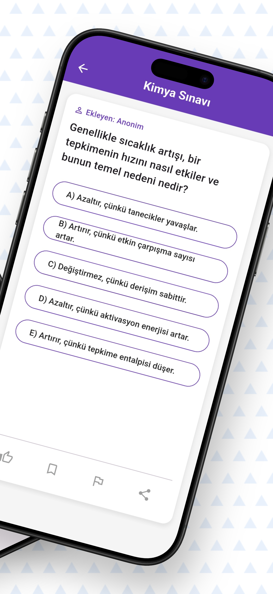

# Sınavgram

**An educational technology project focused on making exam preparation more accessible through digital tools.**

Sınavgram is a software project developed to provide students with a digital platform for exam preparation. The project includes mobile applications and a web presence, bringing its services to users across different platforms.

## 🌐 Official Platforms

| Platform | Link |
|---|---|
| Website | [sinavgram.com](https://sinavgram.com/) |
| Android | [Google Play Store](https://play.google.com/store/apps/details?id=com.mehmetalper04.sinavgram) |
| iOS | [Apple App Store](https://apps.apple.com/us/app/s%C4%B1navgram/id6747351658) |

## 📦 Project Repositories

This organization hosts the source code and development resources associated with the Sınavgram project.

Explore the repositories to learn more about the project's implementation, architecture, and development history.

## 🕰️ Historical References

Sınavgram was previously deployed and made publicly available. The following Internet Archive snapshots preserve historical versions of its public-facing platforms.

- **[Website Archive](https://web.archive.org/web/20261116131736/https://sinavgram.com/)**
- **[Google Play Archive](https://web.archive.org/web/20261116131750/https://play.google.com/store/apps/details?id=com.mehmetalper04.sinavgram)**
- **[App Store Archive](https://web.archive.org/web/20261116131858/https://apps.apple.com/us/app/s%C4%B1navgram/id6747351658)**

These archived pages serve as historical references to the project's public availability and distribution across web and mobile platforms.

## 🎯 Project Goals

- Develop accessible digital solutions for students.
- Build and maintain cross-platform mobile applications.
- Provide a web-based presence for the project.
- Maintain documented and version-controlled software development.

---
## Original Description

## 📱 Sınavgram Nedir?

YKS'ye hazırlanırken sıkıldın mı? Tek başına soru çözmek zor mu geliyor?

Artık yalnız değilsin! **Sınavgram**, YKS hazırlık sürecini baştan aşağı değiştiren, Türkiye'nin en sosyal ve en akıllı soru çözüm platformudur. Sıkıcı ders çalışma rutinini bir kenara bırak ve binlerce öğrenciyle birlikte, tıpkı sosyal medyada gezinir gibi soru çözmenin keyfini çıkar.

> Sınavgram artık sadece bir soru bankası değil; o senin kişisel başarı koçun!

### ✨ Sınavgram'da Seni Neler Bekliyor?

* **📊 Kişisel Başarı Panelin:** Seni isminle karşılayan, puanını, Türkiye sıralamanı, günlük hedeflerini ve rozetlerini anlık olarak gösteren kişisel bir ana sayfa. En önemlisi, Sınavgram artık senin için analiz yapıyor:
  * **Akıllı Ders Önerisi:** En çok yanlış yaptığın dersi tespit eder ve seni doğrudan o derse yönlendirir.
  * **Haftalık Konu Tekrarı:** Son 7 günde en çok zorlandığın konuyu bulur ve sana konu anlatım PDF'ini önerir.
* **🤖 Yapay Zeka ile Çözüm:** Bir soruya cevap verdikten sonra kartı sağa kaydır ve anında adım adım yapay zeka çözümünü gör! Nerede hata yaptığını, doğru cevabın neden doğru olduğunu ve sorunun mantığını derinlemesine anla.
* **🏆 Sıralama ve Rozet Sistemi:** Rekabet başlasın! Puanını artırarak tüm Sınavgram kullanıcıları arasındaki genel sıralamanı gör. Başarılarını altın, gümüş ve bronz rozetlerle taçlandırarak profilini özelleştir.
* **🎨 Kişiselleştirilebilir Temalar:** Uygulamanı kendi tarzına göre ayarla! Ayarlar menüsünden Mor, Mavi veya Yeşil renk temalarından birini seçerek Sınavgram'ı kendine özel hale getir.
* **🔔 Akıllı Bildirimler:** Motivasyonunu asla kaybetme! Günlük hedefine göre sana özel hatırlatmalar gönderen akıllı bildirim sistemi ile her zaman bir adım önde ol. İstersen bu bildirimleri ayarlardan kolayca yönetebilirsin.
* **📲 Reels Tarzı Soru Akışı:** Soru bankalarında boğulma! Ana sayfanda karşına çıkan binlerce soruyu beğen, kaydır, işaretle veya cevabını anında gör. Ders çalışmak hiç bu kadar akıcı olmamıştı.
* **📚 Kişisel Soru Bankanı Oluştur:** Yanlış yaptığın, favorilerine eklediğin veya daha sonra bakmak için işaretlediğin tüm sorular profilinde birikir. Kişiye özel bu soru bankasıyla eksiklerini kapatmak artık çok daha kolay.
* **🗂️ Devasa PDF Arşivi:** Tüm derslerin alt konularına ait güncel konu anlatım PDF'lerine tek bir yerden ulaş.

### 💡 Neden Sınavgram Farklı?

Çünkü Sınavgram bir uygulamadan daha fazlasıdır; burası yaşayan bir **TOPLULUKTUR**. Sınav stresiyle birlikte başa çıkacağın, birbirine yardım ederek netlerini yükselteceğin, motive olacağın on binlerce öğrencinin arasına katıl.

Hayallerindeki üniversiteye giden yolda en sosyal ve en akıllı partnerin Sınavgram!

**Hemen ücretsiz indir, topluluğa katıl ve netlerini artırmaya başla!**

---
## Translation

## 📱 What is Sınavgram?

Bored while preparing for YKS? Finding it hard to solve questions all by yourself?

You're not alone anymore! **Sınavgram** is Turkey's most social and smartest question-solving platform that completely transforms the YKS preparation process. Leave boring study routines behind and enjoy solving questions alongside thousands of students, just like scrolling through social media.

> Sınavgram is no longer just a question bank; it's your personal success coach!

### ✨ What Awaits You in Sınavgram?

* **📊 Personal Success Dashboard:** A personalized home screen that greets you by name and displays your score, national ranking, daily goals, and badges in real time. Most importantly, Sınavgram now analyzes your performance for you:
  * **Smart Subject Recommendation:** Identifies the subject where you make the most mistakes and directs you straight to it.
  * **Weekly Topic Review:** Finds the topic you struggled with the most over the last 7 days and recommends its study guide PDF.
* **🤖 AI-Powered Solutions:** Swipe right on the card after answering a question to instantly view a step-by-step AI solution! Deeply understand where you went wrong, why the correct answer is right, and the core logic behind the question.
* **🏆 Leaderboard & Badge System:** Let the competition begin! Boost your score to see your overall ranking among all Sınavgram users. Customize your profile by crowning your achievements with gold, silver, and bronze badges.
* **🎨 Customizable Themes:** Tailor the app to your own style! Make Sınavgram uniquely yours by choosing from Purple, Blue, or Green color themes in the settings menu.
* **🔔 Smart Notifications:** Never lose your motivation! Stay one step ahead with a smart notification system that sends personalized reminders based on your daily goals. You can easily manage these notifications in settings whenever you want.
* **📲 Reels-Style Question Feed:** Don't drown in traditional question banks! Like, swipe, bookmark, or instantly view the answers to thousands of questions on your home feed. Studying has never been this seamless.
* **📚 Build Your Personal Question Bank:** Every question you get wrong, add to your favorites, or bookmark for later is saved in your profile. Closing your knowledge gaps is now much easier with this custom-tailored question bank.
* **🗂️ Massive PDF Archive:** Access up-to-date study guide PDFs covering all subtopics across every subject in one single place.

### 💡 Why is Sınavgram Different?

Because Sınavgram is more than just an app; it is a living **COMMUNITY**. Join tens of thousands of students where you can overcome exam stress together, boost your scores by helping one another, and stay motivated.

Sınavgram is your smartest and most social partner on the road to your dream university!

**Download now for free, join the community, and start boosting your scores!**

---

## Screenshots

  
  
  
  
  
  
  
  

*Developed and maintained as an independent software project.*
