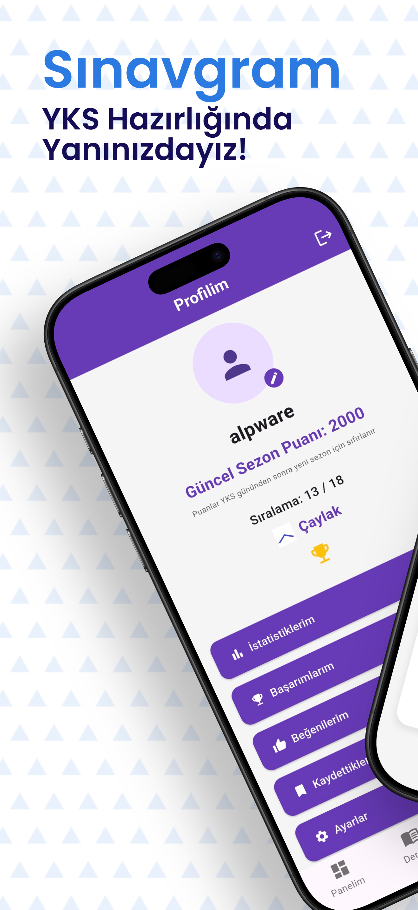
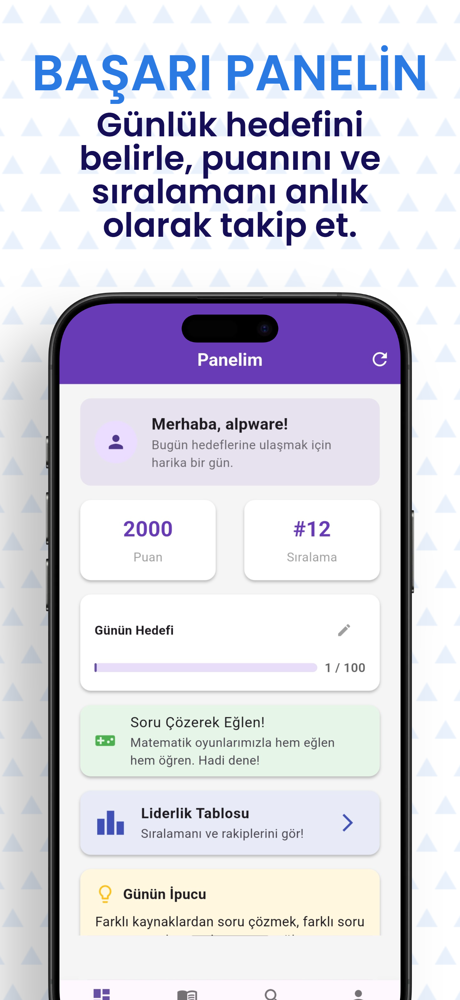
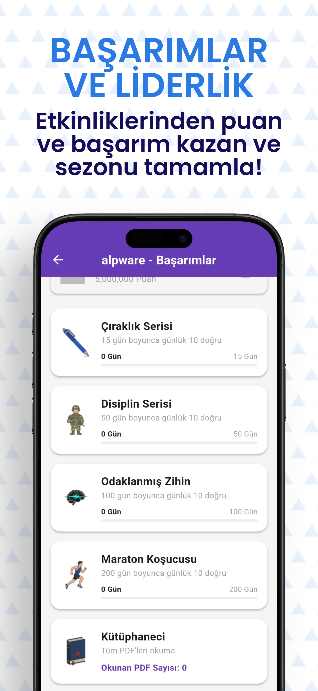
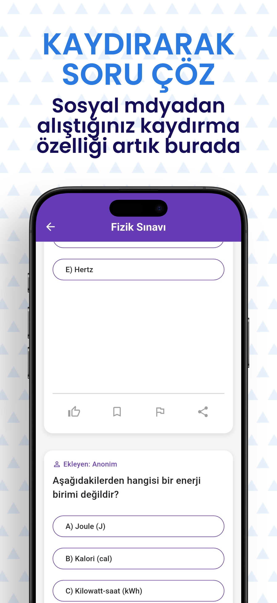
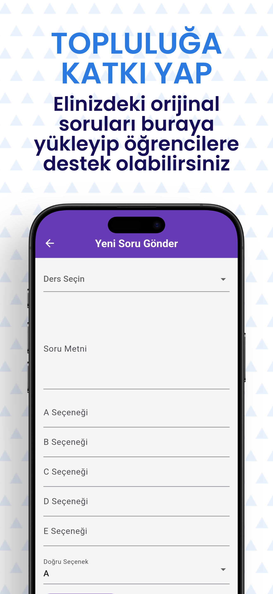
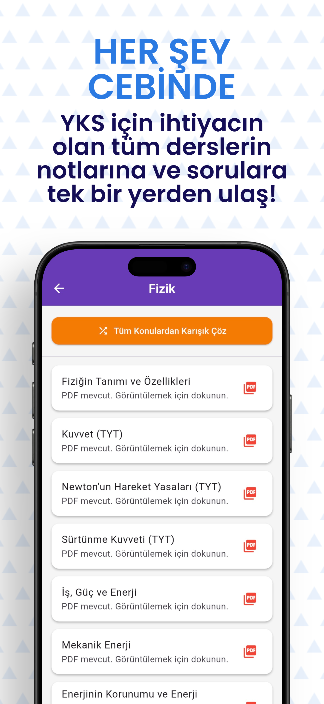
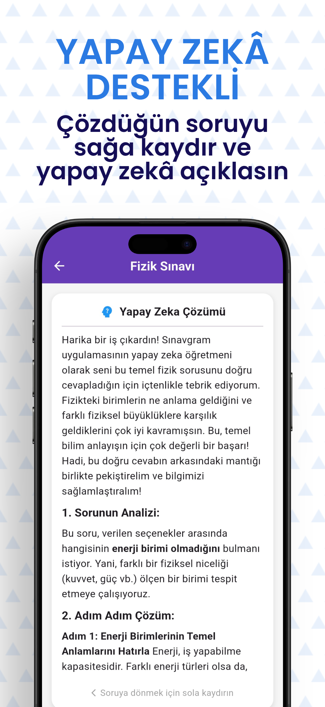

# Sınavgram

**An educational technology project focused on making exam preparation more accessible through digital tools.**

Sınavgram is a software project developed to provide students with a digital platform for exam preparation. The project includes mobile applications and a web presence, bringing its services to users across different platforms.

## 🌐 Official Platforms

| Platform | Link |
|---|---|
| Website | [sinavgram.com](https://sinavgram.com/) |
| Android | [Google Play Store](https://play.google.com/store/apps/details?id=com.mehmetalper04.sinavgram) |
| iOS | [Apple App Store](https://apps.apple.com/us/app/s%C4%B1navgram/id6747351658) |

## 📦 Project Repositories

This organization hosts the source code and development resources associated with the Sınavgram project.

Explore the repositories to learn more about the project's implementation, architecture, and development history.

## 🕰️ Historical References

Sınavgram was previously deployed and made publicly available. The following Internet Archive snapshots preserve historical versions of its public-facing platforms.

- **[Website Archive](https://web.archive.org/web/20261116131736/https://sinavgram.com/)**
- **[Google Play Archive](https://web.archive.org/web/20261116131750/https://play.google.com/store/apps/details?id=com.mehmetalper04.sinavgram)**
- **[App Store Archive](https://web.archive.org/web/20261116131858/https://apps.apple.com/us/app/s%C4%B1navgram/id6747351658)**

These archived pages serve as historical references to the project's public availability and distribution across web and mobile platforms.

## 🎯 Project Goals

- Develop accessible digital solutions for students.
- Build and maintain cross-platform mobile applications.
- Provide a web-based presence for the project.
- Maintain documented and version-controlled software development.

---

  
  
  
  
  
  
  
  

*Developed and maintained as an independent software project.*
